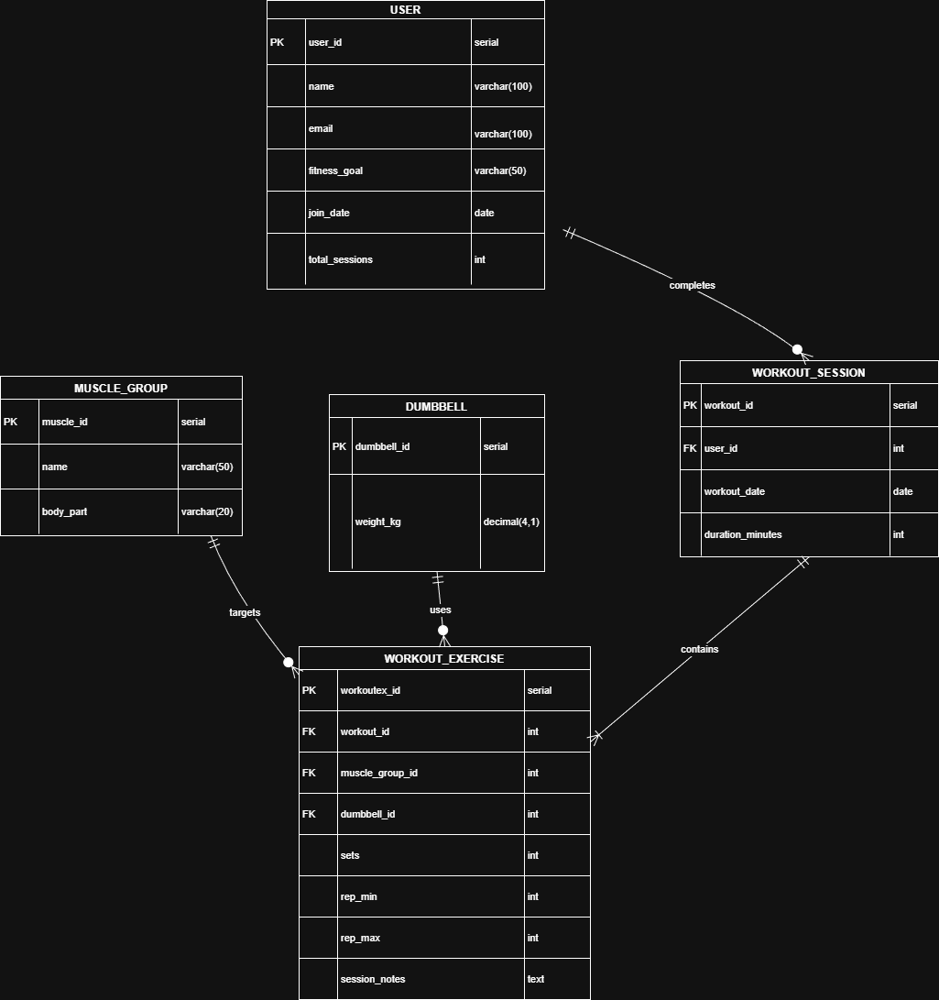

# DUMBBELLPRO-DATABASE

A PostgreSQL database for a strength-training app. DumbbellPro links each user's workout sessions to the muscle groups trained, dumbbell weights, sets and repetitions.

🎓 **Context**

Thiago Pena Silverio developed this project for the Data Management module of the Higher Diploma in Data Analytics at City College Dublin. The consulting report explains the relational design, indexing choices and proposed handling of consent, retention and deletion.



📁 **Folders**

- [SQL](SQL/) contains the schema, sample data generator, eight analytical queries and validation checks.
- [Diagrams](Diagrams/) contains the original entity relationship diagram.
- [Documentation](Documentation/Consulting_Report.pdf) contains the 13-page consulting report.

🛠️ **Tech Stack**

PostgreSQL and SQL, including foreign keys, check constraints, indexes, common table expressions and aggregate queries.

🎖️ **Features**

The sample contains 15 fictional users, 90 sessions and 270 exercise records. Each session has three exercises and totals 12 sets. The queries rank muscle groups by sets, estimate training volume from weights and rep ranges, and identify inactive users. Session dates and durations are generated randomly within fixed ranges in March 2026. The inactivity query compares those sample dates with the day it runs.

🖥️ **How to Run**

From the repository root, use a PostgreSQL account that can create a database. Start with a fresh database and run these commands in order:

```sh
createdb dumbbellpro
psql -X -v ON_ERROR_STOP=1 -d dumbbellpro -f SQL/01_Schema.sql
psql -X -v ON_ERROR_STOP=1 -d dumbbellpro -f SQL/02_Sample_Data.sql
psql -X -v ON_ERROR_STOP=1 -d dumbbellpro -f SQL/03_Analysis.sql
psql -X -v ON_ERROR_STOP=1 -d dumbbellpro -f SQL/04_Validation.sql
```

The validation script checks the sample counts and exercises two constraints: a 50 kg dumbbell exceeds the 35 kg limit, and a workout must reference an existing user. All four scripts were also run together in a fresh, in-memory PostgreSQL instance using PGlite.
